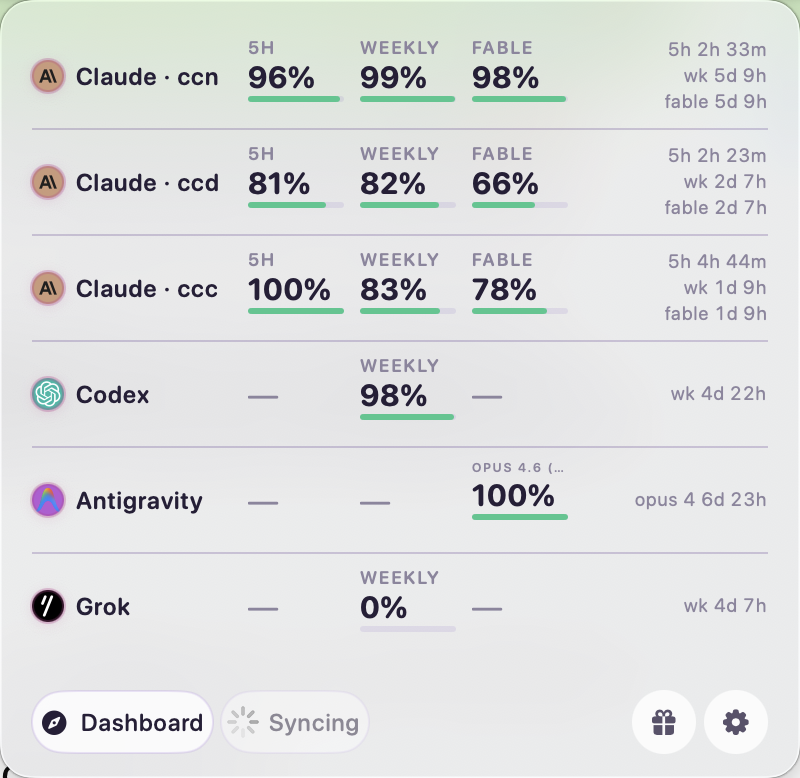

# ClaudeBar Multi-Account

ClaudeBar Multi-Account is a fork of [ClaudeBar](https://github.com/tddworks/ClaudeBar) (based on v0.4.82) that shows **every Claude subscription you own** — plus Codex, Grok and Antigravity — in one compact menu-bar table.



*One glance: 5-hour window, weekly window, and the most constrained specialized-model limit for every account, with reset countdowns on the right.*

Stock ClaudeBar tracks a single Claude account. If you run several — say one per company, each with its own `CLAUDE_CONFIG_DIR` — you had to keep switching. This fork gives each account its own row:

* **Extra Claude accounts** are declared in `~/.claudebar/settings.json`. Each one runs the real `claude /usage` CLI with `CLAUDE_CONFIG_DIR` pointed at that profile, so the CLI owns its own token refresh — no credential copying, nothing that can log a profile out.
* **Compact overview** — one 52pt row per provider: name, then **5H** (session window, or `—` when the plan has none), **WEEKLY**, and a third column with the **most constrained specialized-model limit** (Fable for Claude, the scarcest Gemini model for Antigravity), each with a percentage, a status bar, and a **resets** column at the far right (`5h 2h 47m / wk 5d 9h / fable 5d 9h`). Six accounts fit without scrolling.
* **Quiet menu-bar icon** — a monochrome template image that turns red only when the selected account's 5-hour or weekly window is critical or depleted, never for per-model quotas.
* **Headerless, frosted popover** — the logo header, status pill and close button are gone; the bottom bar is just Dashboard, Refresh, sponsor and settings, over an `NSVisualEffectView` glass background (toggle in Settings → Appearance).
* **Codex windows classified by duration** — ChatGPT Pro exposes only a weekly Codex bucket; it is no longer mislabeled as a 5-hour window.
* **Antigravity without the app running** — process detection no longer needs a PTY, the stored Google token is refreshed in memory, and quotas fall back to the Cloud Code per-model endpoint (internal/unnamed models are skipped).
* **Sparkle auto-update is disabled**, so upstream releases can never silently replace the fork.

Everything else is stock ClaudeBar. Built by [nftstory](https://github.com/nftstory); not affiliated with the upstream project. Upstream's MIT license applies (see [LICENSE](LICENSE)).

### Configuring extra accounts

Quit ClaudeBar, then edit `~/.claudebar/settings.json`. Keys are **nested** (dot-notation paths like `"app.compactOverviewEnabled"` are silently ignored):

```json
{
  "app": {
    "overviewModeEnabled": true,
    "compactOverviewEnabled": true
  },
  "claude": {
    "extraAccounts": [
      { "id": "claude-work", "label": "Claude · work", "configDir": "/Users/you/.claude-work" },
      { "id": "claude-side", "label": "Claude · side", "configDir": "/Users/you/.claude-side" }
    ]
  },
  "codex": {
    "extraAccounts": [
      { "id": "codex-side", "label": "Codex · side", "codexHome": "/Users/you/.codex-side" }
    ]
  }
}
```

Each `configDir` is a directory you have logged into with `CLAUDE_CONFIG_DIR=<dir> claude login`; each `codexHome` one you have logged into with `CODEX_HOME=<dir> codex login`. The default `~/.claude` and `~/.codex` accounts remain the first row of their group.

### Building and installing

```bash
brew install tuist
tuist install
tuist generate --no-open
tuist build ClaudeBar -C Release
codesign --force --deep -s - build/ClaudeBar.app   # ad-hoc signing
cp -R build/ClaudeBar.app /Applications/
```

Uninstall the Homebrew cask first (`brew uninstall --cask claudebar`) so it cannot clobber the fork. If you launch the app from a terminal, do it with a clean environment (`env -i HOME=$HOME USER=$USER PATH=$PATH /Applications/ClaudeBar.app/Contents/MacOS/ClaudeBar &`) — an inherited `CLAUDE_CONFIG_DIR` confuses the spawned `claude /usage`.

---

## Upstream documentation

The sections below are carried over from the upstream ClaudeBar README.

## Requirements

- macOS 15+
- Swift 6.2+
- CLI tools installed for providers you want to monitor:
  - [Claude CLI](https://claude.ai/code) (`claude`)
  - [Codex CLI](https://github.com/openai/codex) (`codex`)
  - [Gemini CLI](https://github.com/google-gemini/gemini-cli) (`gemini`)
  - [GitHub Copilot](https://github.com/features/copilot) - Configure credentials in Settings
  - [Antigravity](https://antigravity.google) - Auto-detected when running locally
  - [Z.ai](https://z.ai/subscribe) - Configure Claude Code with GLM Coding Plan endpoint
  - [Kimi](https://www.kimi.com/code/console) (`kimi`) - CLI mode (recommended) or API mode (see below)
  - [Kiro](https://kiro.dev) (`kiro-cli`) - Requires kiro-cli installation (see below)
  - [Amp](https://ampcode.com) (`amp`) - Auto-detected when CLI is installed
  - [OpenCode Go](https://opencode.ai/go) (`opencode`) - Tracks OpenCode Go usage windows (5hr/$12, weekly/$30, monthly/$60) via local SQLite DB
  - [Oh My Pi](https://omp.sh) (`omp`) - Aggregates account usage via `omp usage --json`, showing rate-limit windows and, where reported, capped USD money cards or uncapped spend notes
  - [Grok Build](https://docs.x.ai) (`grok`) - Tracks xAI credit usage (weekly window + per-product Grok Build / Imagine / Voice limits) using the CLI's local OAuth credentials

### Kimi Setup

Kimi supports two probe modes, configurable in **Settings > Kimi Configuration**:

**CLI Mode (Recommended)** - Launches the interactive `kimi` CLI and sends `/usage` to fetch quota data. Requires `kimi` CLI installed (`uv tool install kimi-cli`). No Full Disk Access needed.

**API Mode** - Calls the Kimi API directly using browser cookie authentication. Requires **Full Disk Access** for ClaudeBar to read the `kimi-auth` browser cookie:
1. Open **System Settings** > **Privacy & Security** > **Full Disk Access**
2. Toggle **ClaudeBar** on (or click `+` and add it)
3. Restart ClaudeBar

You can also set the `KIMI_AUTH_TOKEN` environment variable to bypass cookie reading in API mode.

### Kiro Setup

Kiro monitors AWS Kiro (formerly CodeWhisperer) usage through the `kiro-cli` command-line tool.

**Installation**: `uv tool install kiro-cli` or `pip install kiro-cli`

**Authentication**: Run `kiro-cli` and follow the login prompts.

**Kiro IDE Users**: If you use Kiro IDE, simply install kiro-cli. Both share the same authentication, so no additional login is required.


## Development

The project uses [Tuist](https://tuist.io) for dependency management and Xcode project generation.

### Quick Start

```bash
# Install Tuist (if not installed)
brew install tuist

# Install dependencies
tuist install

# Generate Xcode project and open
tuist generate
open ClaudeBar.xcworkspace
```

### Build & Test

```bash
# Build the project
tuist build

# Run all tests
tuist test

# Run tests with coverage
tuist test --result-bundle-path TestResults.xcresult -- -enableCodeCoverage YES

# Build release configuration
tuist build ClaudeBar -C Release
```

### SwiftUI Previews

After opening in Xcode, SwiftUI previews will work with `Cmd+Option+Return`. The project is configured with `ENABLE_DEBUG_DYLIB` for preview support.

## Architecture

> **Full documentation:** [docs/ARCHITECTURE.md](docs/ARCHITECTURE.md)

ClaudeBar uses a **layered architecture** with `QuotaMonitor` as the single source of truth:

| Layer | Purpose |
|-------|---------|
| **App** | SwiftUI views consuming domain directly (no ViewModel) |
| **Domain** | Rich models, `QuotaMonitor`, repository protocols |
| **Infrastructure** | Probes, storage implementations, adapters |

### Key Design Decisions

- **Single Source of Truth** - `QuotaMonitor` owns all provider state
- **Repository Pattern** - Settings and credentials abstracted behind injectable protocols
- **Protocol-Based DI** - `@Mockable` protocols enable testability
- **Chicago School TDD** - Tests verify state changes, not method calls
- **No ViewModel/AppState** - Views consume domain directly


## License

MIT
